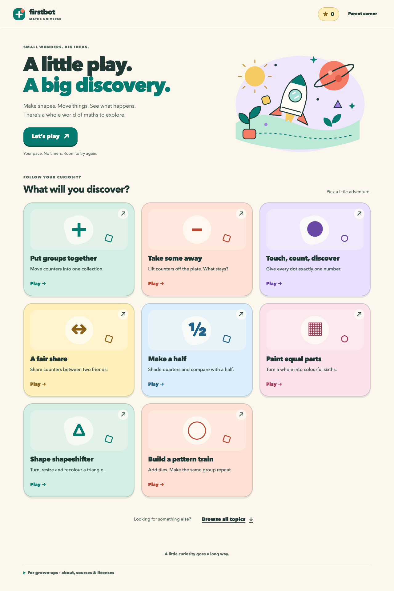
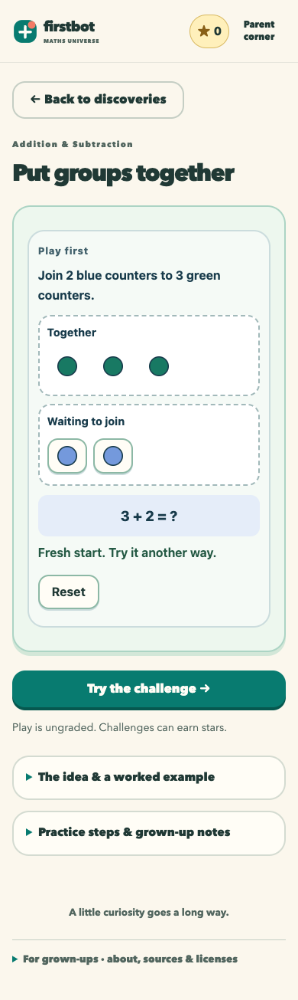

# Maths Universe

A browser learning playground with **8 hands-on discoveries** and a library of **576 Mathematics topics across 12 worlds**. No age, name, camera, microphone, robot or model API is required to play.

Start by moving counters, taking some away, touching dots to count, sharing fairly, shading equal parts, changing shapes, or building a pattern train. The discovery playgrounds are ungraded: they do not change stars, attempts or completions. Supported practice questions also offer object-based aids.

The rest of the library uses the original worked examples, revealed one step at a time. **Not every topic has a hands-on activity.** Explanations and grown-up notes are available in expandable panels rather than displayed all at once.

Each topic provides an introductory explanation, worked example, two practice questions and a boss question: **1,728 authored questions**. There are **282 parent-observed practical activities**. The local Python edition saves progress in SQLite and preserves an earlier starter adventure at `/starter`. The public edition saves progress in the browser; both offer parent earning settings, audited adjustments and history.

## Play online

**https://triminhpham.github.io/maths-universe/**

The public GitHub Pages edition runs entirely in your browser. All 576 topics are playable without installing Python or signing in. Progress, stars and parent notes are stored in that browser's IndexedDB, not uploaded to a server. Different browsers/devices have separate progress; clearing site data removes it. It does not sync with the local Mac edition. Device-local parent controls are not password-protected and affect only that browser's progress.

The library's challenges are authored quizzes, not 576 distinct mini-games or a certification of mastery. Questions are not unlimited dynamically generated exercises. The visual redesign has browser regression coverage; it has not been evaluated in a learning-outcomes study.

To rebuild the public edition, run `python3 build_public.py`; GitHub Pages serves the `docs/` directory. Optional browser acceptance: install Playwright/Chromium, then run `python3 tests/public_browser.py`. This exercises every topic against the browser persistence engine plus real mobile interactions, reload/resume, reward deduplication and visitor isolation.

## Run locally

Python 3.11 or newer:

```sh
git clone https://github.com/TriMinhPham/maths-universe.git
cd maths-universe
python3 -m venv .venv
source .venv/bin/activate
python -m pip install -r requirements.txt
python laptop/adventure_app.py --host 127.0.0.1 --port 8770
```

On Windows, activate using `.venv\Scripts\activate` instead.

Open **http://127.0.0.1:8770** on the computer running the app.

## Screenshots

Actual browser screenshots from an isolated demo—not learner records:




## Verify

```sh
python -m unittest discover -s tests -p 'test_full_math.py' -v
python -O -m unittest discover -s tests -p 'test_full_math.py' -v
python3 build_public.py
python3 tests/test_visual_learning.py
python3 tests/visual_browser.py
python3 tests/visual_acceptance.py
python3 tests/public_browser.py
```

The suite exercises every authored topic plus persistence, reward deduplication, concurrency, rollback, invalid-input handling, exact arithmetic, history and versioned practical observations. All tests use disposable databases. Browser/HTTP acceptance during development also completed all 576 stages and 1,728 questions; these synthetic tests do not establish learning outcomes or real physical activity.

## Privacy and security

- Personal progress, databases, credentials and agent transcripts are **not included**.
- A new local installation starts its own `.private/math-adventure.sqlite3` database.
- Parent controls trust access to the local computer; they are **not password-protected**.
- Keep this service loopback-only. Do not publish it through a tunnel/reverse proxy without adding authentication, per-user storage and appropriate public-service security controls.
- The app contains no robot firmware or device integration. Robot-related shared-module terminology is legacy code, not a requirement to own hardware.

## Curriculum attribution and content licensing

Based on the Marble Skill Taxonomy (v1), © Generative Spark, Inc. (Marble), https://withmarble.com, from https://github.com/withmarbleapp/os-taxonomy at commit `7bd8b6794cb78d9ca18216adb935f3cfd59cf5ac`.

The vendored database is ODbL 1.0 and upstream content is CC BY-SA 4.0. The adapted lesson content in `laptop/full_math_lessons.json` is distributed under CC BY-SA 4.0; taxonomy-derived database selection/mapping retains ODbL obligations. Preserve attribution and share-alike requirements. See `laptop/vendor/os-taxonomy/NOTICE.md`, `PROVENANCE.md`, `LICENSE` and `LICENSE-CONTENT` for the original notices and terms. Not endorsed by Marble.

No additional blanket software license is granted by this publication; the data/content licenses above remain applicable to their respective materials.
