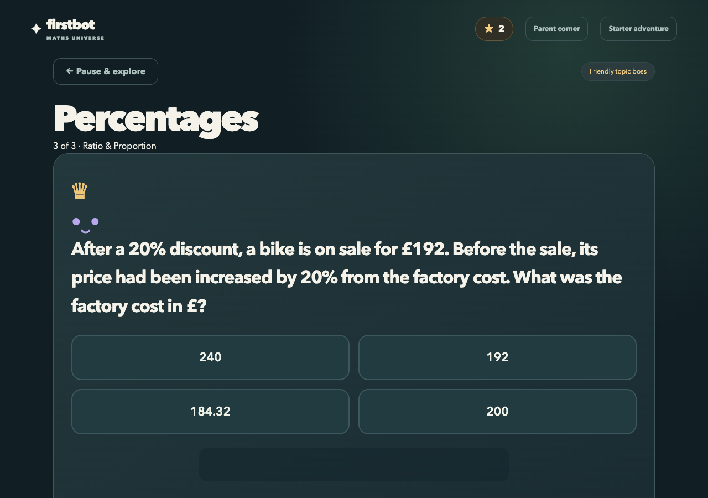
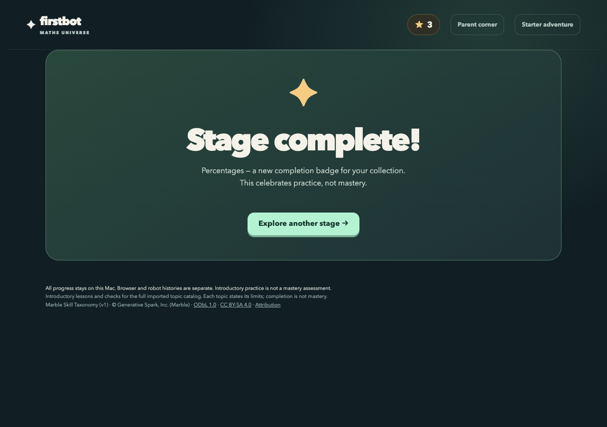

# Maths Universe

A local browser learning adventure covering **576 Mathematics topics across 12 worlds**. No age, name, camera, microphone, robot or model API is required to play.

Each topic provides an introductory explanation, worked example, two practice questions and a boss question: **1,728 authored questions**. There are **282 parent-observed practical activities**. Progress and stars persist locally in SQLite; parent controls include earning settings, audited adjustments and history. An earlier starter adventure remains available at `/starter`.

**This repository shares the runnable source, not a hosted website.** It is a gamified quiz adventure, not 576 distinct mini-games or a certification of mastery. Questions are authored, not unlimited dynamically generated exercises.

## Run locally

Python 3.11 or newer:

```sh
git clone https://github.com/TriMinhPham/maths-universe.git
cd maths-universe
python3 -m venv .venv
source .venv/bin/activate
python -m pip install -r requirements.txt
python laptop/adventure_app.py --host 127.0.0.1 --port 8770
```

On Windows, activate using `.venv\Scripts\activate` instead.

Open **http://127.0.0.1:8770** on the computer running the app.

## Screenshots

Actual browser screenshots from an isolated demo—not learner records:




## Verify

```sh
python -m unittest discover -s tests -p 'test_full_math.py' -v
python -O -m unittest discover -s tests -p 'test_full_math.py' -v
```

The suite exercises every authored topic plus persistence, reward deduplication, concurrency, rollback, invalid-input handling, exact arithmetic, history and versioned practical observations. All tests use disposable databases. Browser/HTTP acceptance during development also completed all 576 stages and 1,728 questions; these synthetic tests do not establish learning outcomes or real physical activity.

## Privacy and security

- Personal progress, databases, credentials and agent transcripts are **not included**.
- A new local installation starts its own `.private/math-adventure.sqlite3` database.
- Parent controls trust access to the local computer; they are **not password-protected**.
- Keep this service loopback-only. Do not publish it through a tunnel/reverse proxy without adding authentication, per-user storage and appropriate public-service security controls.
- The app contains no robot firmware or device integration. Robot-related shared-module terminology is legacy code, not a requirement to own hardware.

## Curriculum attribution and content licensing

Based on the Marble Skill Taxonomy (v1), © Generative Spark, Inc. (Marble), https://withmarble.com, from https://github.com/withmarbleapp/os-taxonomy at commit `7bd8b6794cb78d9ca18216adb935f3cfd59cf5ac`.

The vendored database is ODbL 1.0 and upstream content is CC BY-SA 4.0. The adapted lesson content in `laptop/full_math_lessons.json` is distributed under CC BY-SA 4.0; taxonomy-derived database selection/mapping retains ODbL obligations. Preserve attribution and share-alike requirements. See `laptop/vendor/os-taxonomy/NOTICE.md`, `PROVENANCE.md`, `LICENSE` and `LICENSE-CONTENT` for the original notices and terms. Not endorsed by Marble.

No additional blanket software license is granted by this publication; the data/content licenses above remain applicable to their respective materials.
